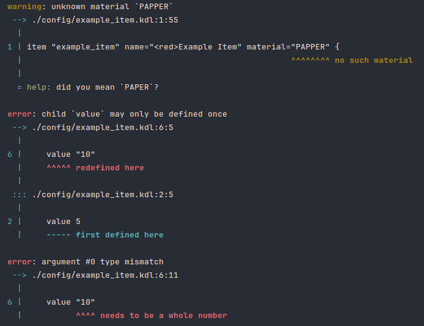

# Kidl

[](https://jitpack.io/#AdamBurdik/kidl)

Simple library to parse and validate kdl configuration files.
Basically just a port of [lint](https://github.com/AdamBurdik/lint) for [kdl](https://kdl.dev) format

But its little more complex, cause kdl has more value locations.
I made lint cause it was easier to grasp parsing validation in easier format such as yml.


## Example

Lets imagine this simple item definition

```kdl
item "example_item" name="<red>Example Item" material="PAPPER" {
    value 5
    variable "foo"
    variable "bar"
    item-model "example_model"
    value 10
}
```

We can parse and validation this file:

```java
// Predefined set of valid materials
Set<String> MATERIALS = Set.of("PAPER", "STONE", "ORANGE_WOOL", "ORANGE_DYE");

// Predefined rules for item children
enum ItemChild implements ChildKind {
    VALUE("value", Cardinality.ONE),
    VARIABLE("variable", Cardinality.MANY),
    ITEM_MODEL("item-model", Cardinality.OPTIONAL);

    private final String id;
    private final Cardinality cardinality;

    ItemChild(String id, Cardinality cardinality) {
        this.id = id;
        this.cardinality = cardinality;
    }

    @Override public String id() { return id; }
    @Override public Cardinality cardinality() { return cardinality; }
}

Kidl kidl = Kidl.builder()
        .ansiRenderer()
        .standardExceptionTranslation()
        .build();
        
var result kidl.load(Path.of("./config/example_item.kdl"), (id, ctx, cursor) -> {
    if (!id.equals("item")) return;
    
    String itemId = cursor.arguments().getString(0);
    
    String name = cursor.properties().getString("name");
    String material = cursor.properties().oneOf("material", MATERIALS);
    
    Integer value = null;
    String model = null;
    List<String> variables = new ArrayList<>();
    
    for (TypedCursor<ItemChild> child : cursor.children(ItemChild.class)) {
        switch (child.kind()) {
            case VALUE -> value = child.arguments().getInt(0);
            case VARIABLE -> variables.add(child.arguments().getString(0));
            case ITEM_MODEL -> model = child.arguments().getString(0);
        }
    }
}


if (result.hasErrors()) {
    System.out.println("example_item has errors");
}
```

This code reports following issues:
```
warning: unknown material `PAPPER`
 --> ./config/example_item.kdl:1:55
  |
1 | item "example_item" name="<red>Example Item" material="PAPPER" {
  |                                                       ^^^^^^^^ no such material
  |
  = help: did you mean `PAPER`?

error: child `value` may only be defined once
 --> ./config/example_item.kdl:6:5
  |
6 |     value "10"
  |     ^^^^^ redefined here
  |
 ::: ./config/example_item.kdl:2:5
  |
2 |     value 5
  |     ----- first defined here

error: argument #0 type mismatch
 --> ./config/example_item.kdl:6:11
  |
6 |     value "10"
  |           ^^^^ needs to be a whole number

```

## Features
- Primitive types (string, int, float, double, long, bool)
- Typed properties, arguments, children


## ANSI Renderer
pretty colors in terminal :O

*Its possible to write renderer for minimessage and use that to inform players*



## How to use

Use [jitpack](https://jitpack.io/#AdamBurdik/kidl) to include it in your project

```kotlin
repositories {
    maven { url = uri("https://jitpack.io") }
}

dependencies {
    implementation("com.github.AdamBurdik:Kidl:<commit>")
}
```

## Credits
- Kidl uses [kdl4j](https://github.com/kdl-org/kdl4j/) for the actual kdl parsing
- Error messages are inspired by rust compiler ones
- Basically port of [lint](https://github.com/AdamBurdik/lint)

## Licence
[MIT](./LICENCE)
